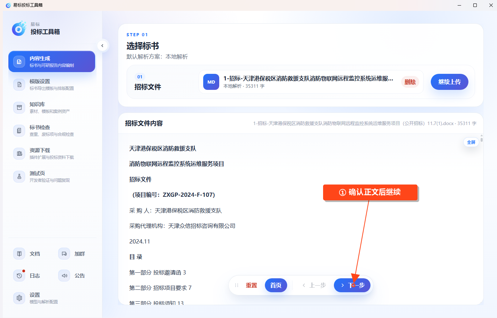
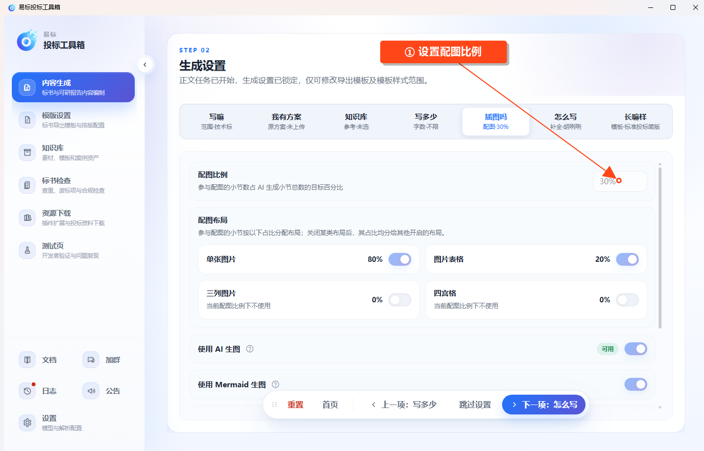
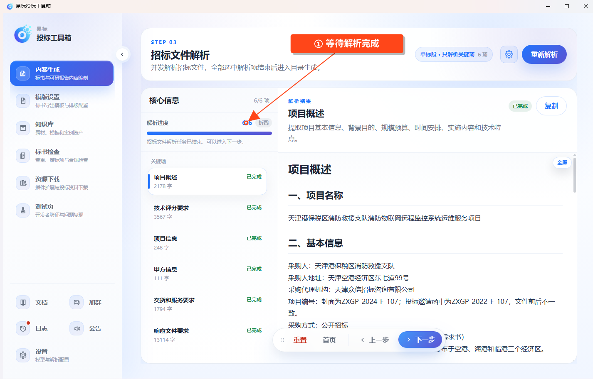
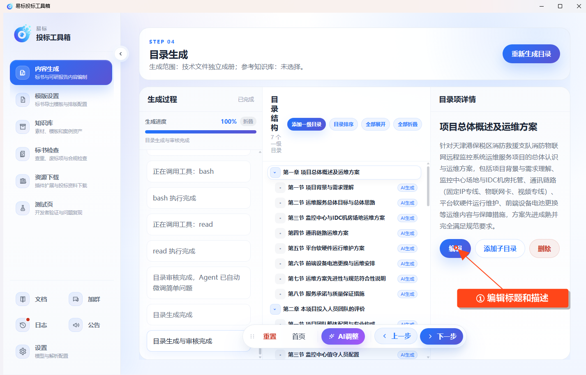
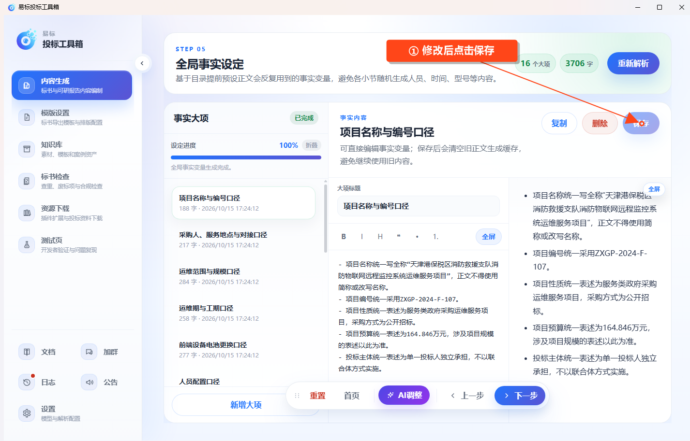
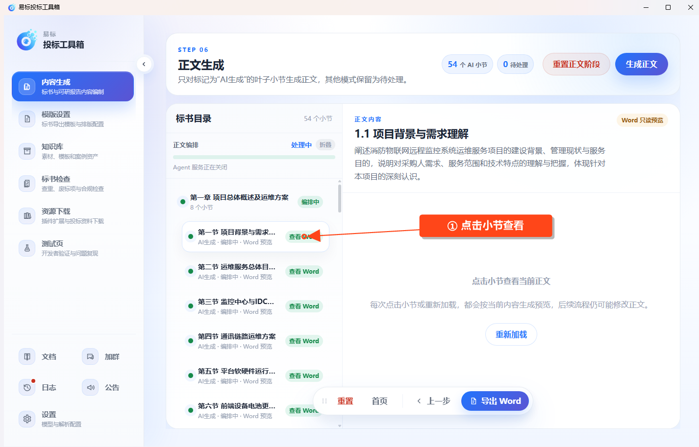

# 生成技术方案

在左侧点击 **内容生成 → 投标文件**。当前按“技术文件独立成册”编制技术方案，流程分为六步。

## 第一步：选择标书

点击 **上传** 选择招标文件。可以通过 **继续上传** 补充其他文件。等待文件解析结束，确认列表显示文件名、正文区能查看内容，再点击 **下一步**。

## 第二步：生成设置

依次检查页面上方七个页签。修改会自动保存；数字输入完成后移开输入框或按回车，确认出现保存提示。

| 页签 | 要做的事 |
| --- | --- |
| 写嘛 | 确认“技术文件独立成册” |
| 我有方案 | 有已有技术方案时上传，并选择原方案目录使用方式 |
| 知识库 | 选择本次编制需要参考的文档或知识条目 |
| 写多少 | 设置全文字数范围、每小节建议字数和表格需求 |
| 插图吗 | 设置配图比例、图片布局和生图方式 |
| 怎么写 | 选择资料缺少具体信息时的处理方式 |
| 长嘛样 | 选择导出模板、模板样式范围及是否进行格式自检修复 |

### 字数与表格

字数单位是 **万字**：填 2 表示 20000 字，填 0.15 表示 1500 字，填 0 表示不限制。每小节建议字数用于估算目录规模，实际正文还会按编排结果分配目标。

“字数不达标修复”是可选项，默认关闭。需要时在开始正文任务前开启，并选择表格需求。

### 配图

配图比例可设为 0%～100%，每档 10%。它表示参与配图的小节占 AI 生成小节的目标比例，不是每页图片占比。

选择单图、图片表格、三列或四宫格等可用布局，再按需要开启 AI 生图、Mermaid 或 HTML。配图比例不为 0 时至少保留一种生图方式和一种可用布局。AI 生图需要先在设置中测试为可用。

HTML 图片二次优化默认关闭，需要时再开启。

### 缺失信息与版式

“怎么写”有三种处理方式：

- **胡咧咧**：允许 AI 为缺少的信息补充具体内容，生成后需要核实。
- **别招欠**：对缺少具体值的信息采用概括表达。
- **放着我来**：保留“待填写”，由你补充。

在“长嘛样”中选择已保存模板，并确定样式应用于“仅技术方案”还是“整个文件”。格式自检修复开启后，会在正文完成时检查版面留白并按需补写；关闭时直接进入 Word 转换。

按 **下一项** 逐项检查，完成后进入招标解析。正文任务一旦开始，生成设置会锁定，仅导出模板和模板样式范围仍可修改；暂停或失败不会解除锁定。

## 第三步：招标文件解析

点击 **开始解析**；如果任务已运行，只需等待。软件整理项目概述、技术评分要求、项目信息、甲方信息、交货和服务要求、响应文件要求等内容。

等待本次解析项全部显示“已完成”，逐项检查结果后进入下一步。多标段文件按页面提示确认需要处理的标段。失败项可根据页面提供的重试入口处理。

## 第四步：生成和检查目录

点击 **生成目录**。需要确认一级目录或补充信息时，按弹窗提示选择并提交，等待目录生成结束。

检查各级标题和小节描述，按需操作：

- 点击目录项，修改标题或描述后点击 **保存**。
- 添加一级目录或子目录，删除不需要的项。
- 点击 **目录排序**，拖动同级目录，再点击 **保存排序**。

修改标题、描述和排序会保留已有正文；重新生成整份目录会替换原结果。生成范围发生变化且页面提示需要重生成时，先完成重生成，再进入下一步。

## 第五步：全局事实设定

点击 **开始解析**，等待项目名称、编号、工期、地点、人员等重复使用的信息整理完成。

逐组检查事实，特别是“待填写”内容。直接编辑后点击 **保存**；缺少内容时可新增大项。已有正文时，保存事实变更需要确认清空旧正文，后续生成使用修改后的信息。

目录和全局事实页面提供的 **AI 调整** 通过桌宠对话完成。点击后按提示打开对话并说明修改要求；未安装或未启用桌宠时，按页面提示处理插件。

## 第六步：生成正文并导出

确认生成设置、目录和全局事实后，点击 **生成正文**。任务在后台进行，切换页面不会取消任务；请保持软件运行。

页面会显示当前阶段、已完成小节、字数和配图情况。正文写完后还会进行后续处理和 Word 转换，应等待 **全部完成**，并确认提示“Word 已全部生成”。

图中展示正文页的目录与预览入口，当前任务尚未完成。

完成后：

1. 点击左侧小节，查看右侧 Word 只读预览。
2. 某个小节需要修改时，使用该小节的 **重新生成**，输入具体要求并等待完成。
3. 点击 **导出 Word**，选择保存位置，等待导出完成后打开文件检查。

需要暂时停止时点击 **暂停**，等待暂停完成；回来后按页面按钮继续。任务失败时根据错误提示处理，再使用继续或重试入口。若只是 Word 转换失败，按页面提示重试转换。

投标文件的正文任务运行或暂停期间不能导出。允许导出时，尚未生成的小节会保留标题和未完成提示；人工填写的小节需要在导出后补全。导出中如有图片失败提示，应核对对应位置。
