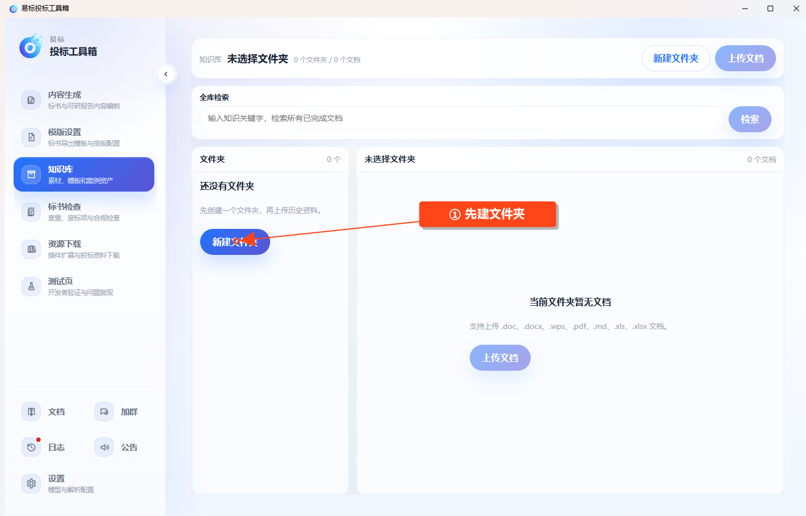

# 使用文档知识库

在左侧点击 **知识库 → 文档知识库**，整理可反复引用的资料、案例和已有方案。

## 上传和查看

1. 点击 **新建文件夹**，按项目或资料类型建立分类。
2. 选中左侧文件夹，再点击 **上传文档**。
3. 等待处理进度完成，文档状态变为“完成”。
4. 点击 **查看条目** 或 **查看 Markdown**，核对提取内容。
5. 如果处理失败，查看原因，处理文件或配置问题后再重试。

超长文档会分段处理，保持软件运行并等待，不必重复上传同一文件。

## 全库检索

在 **全库检索** 中输入关键词并搜索。结果会显示匹配条目及所属文档，可打开结果查看内容和原文位置。结果超过一页时使用分页继续查看，每页最多显示 100 条。

## 在生成任务中引用

编制技术方案时，进入 **投标文件 → 生成设置 → 知识库**，选择需要参考的文档或条目；仅把文件存入知识库，并不等于已经选入当前任务。

可研报告在“报告目录”阶段选择参考知识库。引用前应确认文档已处理完成且内容适用于当前项目。
