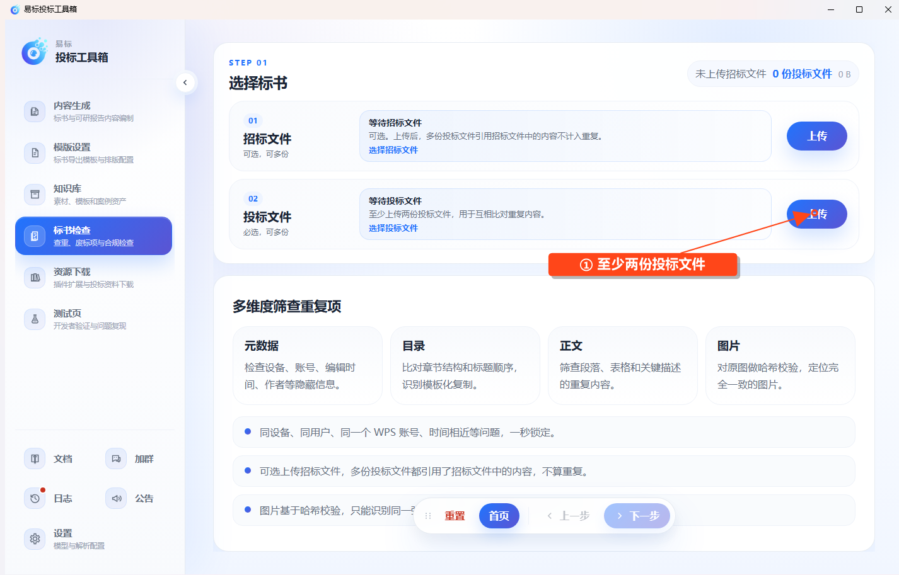

# 标书查重

在左侧点击 **标书检查 → 标书查重**。

## 选择文件

- **招标文件**：可选，可上传多份，用于识别共同引用的来源。
- **投标文件**：至少上传两份，用于相互比较。

确认文件解析完成后点击 **下一步**，进入查重结果页并等待检查。

## 查看结果

页面按四个维度展示状态和结果：

| 维度 | 查看内容 |
| --- | --- |
| 元数据 | 作者、编辑记录及其他可提取的文件属性 |
| 目录 | 章节结构和标题的重复情况 |
| 正文 | 重复段落、表格和关键描述 |
| 图片 | 完全相同的原图 |

多份投标文件共同引用招标文件的内容会结合招标原文处理。图片比较使用文件哈希，经过压缩、截图或修改的相似图片不保证识别。

等待各维度完成后切换页签，展开命中项核对涉及文件及原文。没有命中和任务失败是不同状态，应先确认检查确实完成。

## 导出与重新检查

结果生成后点击 **导出 Excel**，选择保存位置并等待导出完成。任务仍在运行时先等待结束。

修改源文件后，返回上传步骤重新导入修改后的文件，再按页面入口重新查重；只修改电脑上的原文件不会自动更新已导入内容。
