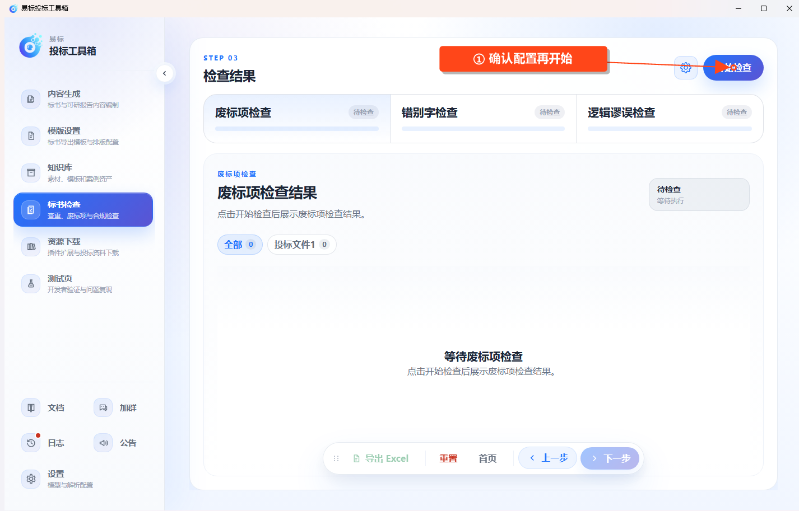

# 废标项检查

在左侧点击 **标书检查 → 废标项检查**。

## 导入并确认检查项

1. 上传招标文件和需要检查的投标文件，等待解析完成。
2. 点击 **下一步**，等待提取无效投标和废标条款。
3. 检查提取内容，按需补充自定义检查项。
4. 进入结果步骤，通过页面的设置入口确认启用哪些检查，再点击 **开始检查**。

图中为检查入口；只有启动任务并等待完成后才会产生检查结果。

## 查看检查结果

- **废标项检查**：检查投标文件是否响应硬性要求。
- **错别字检查**：查找明显的文字错误。
- **逻辑谬误检查**：查找前后矛盾、时间不一致及参数冲突等问题。

等待本次启用的检查全部完成后，按投标文件筛选结果。展开问题查看原文位置、原因和修改建议；确认是误报时，可删除该条并确认提示。

## 导出结果

点击 **导出 Excel**，选择保存位置，等待导出完成。任务运行中先等待结束，再导出已有结果。

AI 检查用于辅助复核。修改源文件后，应重新导入并检查，提交前再核对招标要求与最终投标文件。
