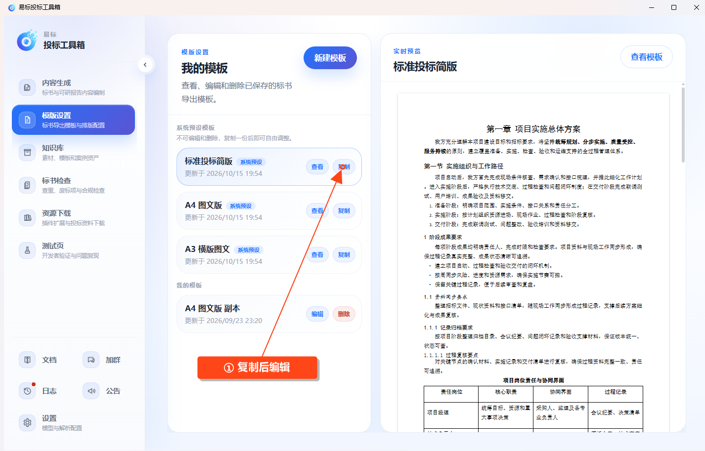
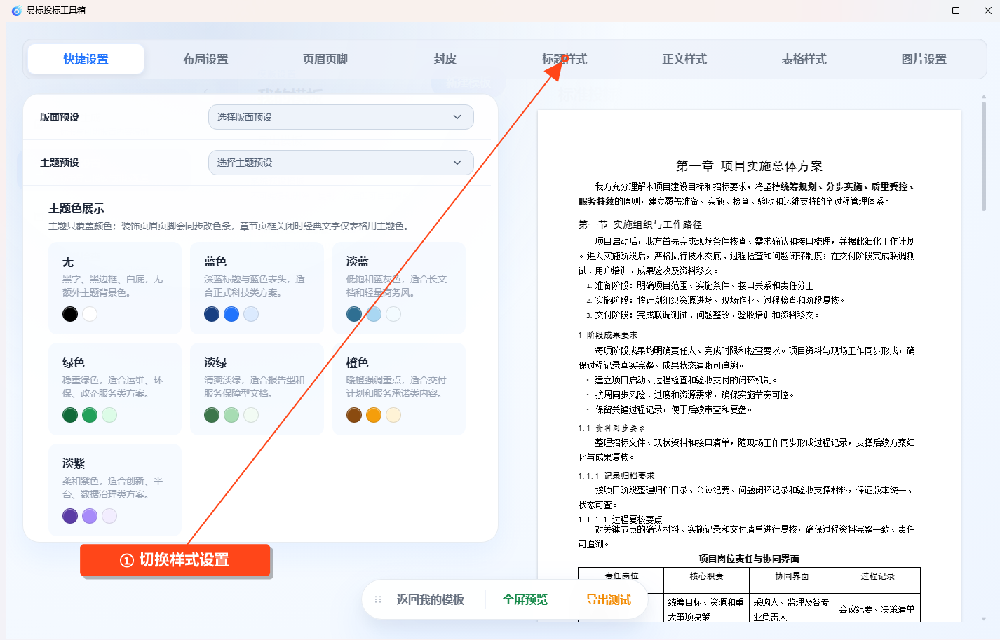

# 模版设置

点击左侧 **模版设置**，管理投标文件导出时使用的版式。

## 选择或新建模板

页面提供“标准投标简版”“A4 图文版”“A3 横版图文”等系统预设。系统预设可以查看、复制，不能直接修改或删除。

需要调整时，复制预设为个人模板，或点击新建模板。个人模板可以编辑、保存和删除。

## 调整样式

打开模板后，根据需要切换 **快捷、布局、页眉页脚、封皮、标题、正文、表格、图片** 等设置区。

可以调整页面尺寸和方向、页边距、页眉页脚、标题与正文样式、表格及图片排版。右侧预览用于查看 Word 版面效果，修改完成后点击 **保存**。

## 应用到文件

- 投标文件：进入 **生成设置 → 长嘛样**，选择模板和样式范围。
- 可研报告：点击 **导出 Word** 后，在模板选择窗口中选择。

保存模板后，还需要在对应任务中选用；不要把模板预览当成已经导出的正式文件。
