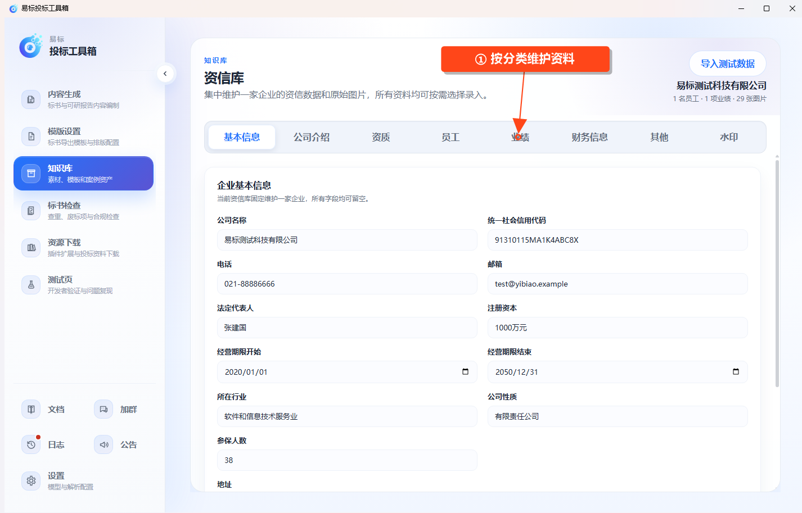

# 使用资信库

在左侧点击 **知识库 → 资信库**，集中保存当前企业的资料。

## 录入资料

按顶部分类分别维护：

- **基本信息、公司介绍**：填写企业基础资料及介绍。
- **资质**：记录资质信息并上传证书图片。
- **员工**：维护人员信息及相关证明图片。
- **业绩**：维护项目经历和证明材料。
- **财务信息、其他**：补充对应资料。
- **水印**：维护水印设置。

基本资料输入完成后移开输入框，等待自动保存提示。资质、员工、业绩等列表通过新增或编辑窗口填写，完成后点击 **保存**。

## 管理附件和条目

在对应记录中上传图片，点击缩略图查看资料。需要修改时打开记录编辑；删除前核对确认提示，避免误删仍需使用的条目。

当前资信库围绕一家企业维护资料。录入完成后，确认各项内容和图片正确即可；保存水印设置本身不代表已给现有文件加水印。
