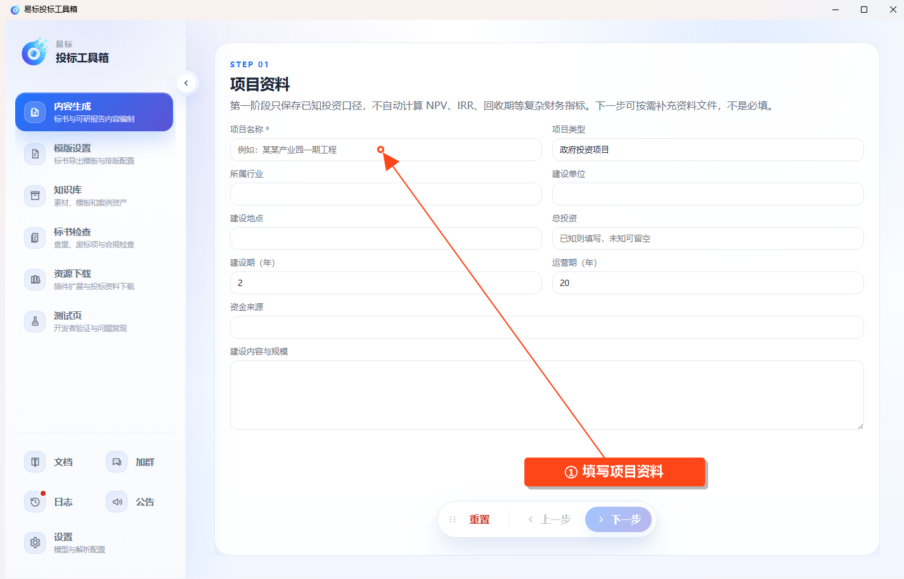

# 生成可行性研究报告

入口为 **内容生成 → 可行性研究报告**，界面标记为 Beta。请先配置可用的文本模型。

## 第一步：项目资料

填写项目名称，选择政府投资项目或企业投资项目，再补充已知的行业、建设单位、地点、总投资、建设期、运营期、资金来源及建设内容。

项目名称为必填。未知投资信息可以留空；该步骤保存已知口径，不自动计算净现值、内部收益率或回收期。

## 第二步：项目资料文件

按需上传项目相关资料，等待文件解析完成并检查内容。文件不是必选项，没有补充资料时可以继续。

## 第三步：资料分析

启动资料分析，等待完成后核对项目背景、建设需求等结果。需要修改时编辑并保存，再进入报告目录。

## 第四步：报告目录

选择适合项目的目录模板，设置目标字数和需要参考的知识库资料，生成报告目录。检查章节结构和标题，按页面入口修改后再继续。

## 第五步：关键参数

生成并核对关键参数。重点处理“待补充”“待确认”信息，编辑后保存。已有正文时，参数变更会使旧正文失效，需要重新生成相关内容。

## 第六步：正文与导出

点击生成正文，等待各章节生成及自动审校结束。按目录查看章节，使用页面提供的编辑、保存功能修改内容。

任务可以暂停和继续。需要提前导出时，先等待暂停完成，再导出当前已完成内容。

点击 **导出 Word**，选择已保存的模板，并确认是否包含可研专用封面、编制说明和基本情况附表。点击 **继续导出**，选择保存位置并等待完成。

没有财务测算数据时只生成项目基本情况表，不会补造财务指标。导出后核对正文、参数、封面和附表中的待补充信息。
