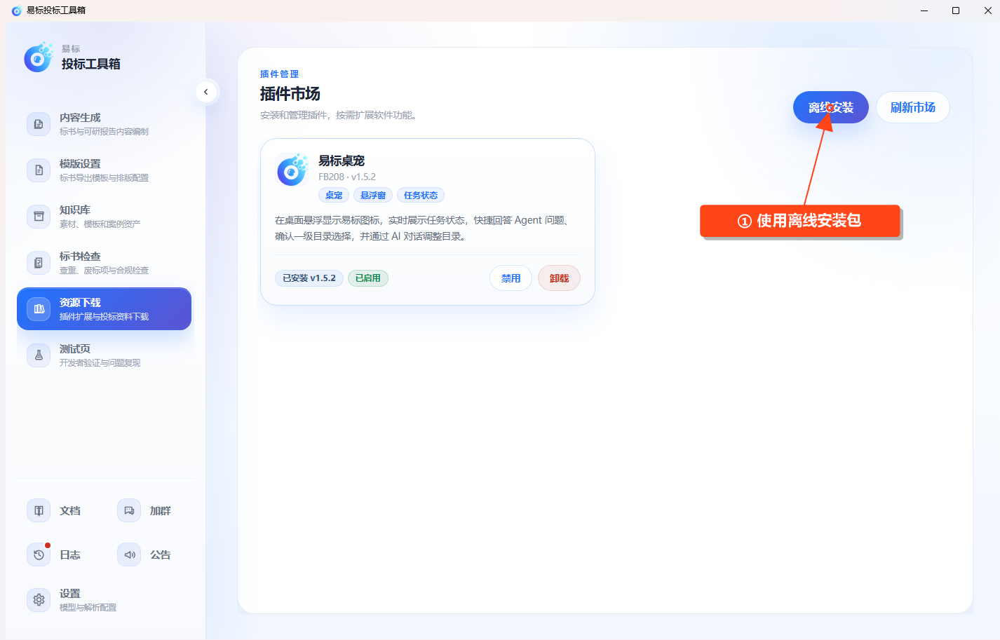

# 插件管理

入口为 **资源下载 → 插件管理**。

## 在线安装

等待插件市场列表加载，查看插件说明和版本后点击 **安装**。安装完成后检查状态，启用插件再使用其功能。

## 离线安装

点击 **离线安装**，选择插件 ZIP 安装包，等待完成。同一插件的安装包可以用于覆盖升级，应先确认包对应的插件和版本。

## 管理已安装插件

- **启用或禁用**：控制插件是否运行。
- **更新**：有新版本时按页面提示安装更新。
- **配置**：插件提供配置入口时，在配置窗口中调整并保存。
- **卸载**：确认后删除插件及其本地配置文件。

易标桌宠提供 AI 对话等入口。目录和全局事实页面的“AI 调整”需要桌宠已安装并启用，具体操作按打开的对话窗口提示进行。
