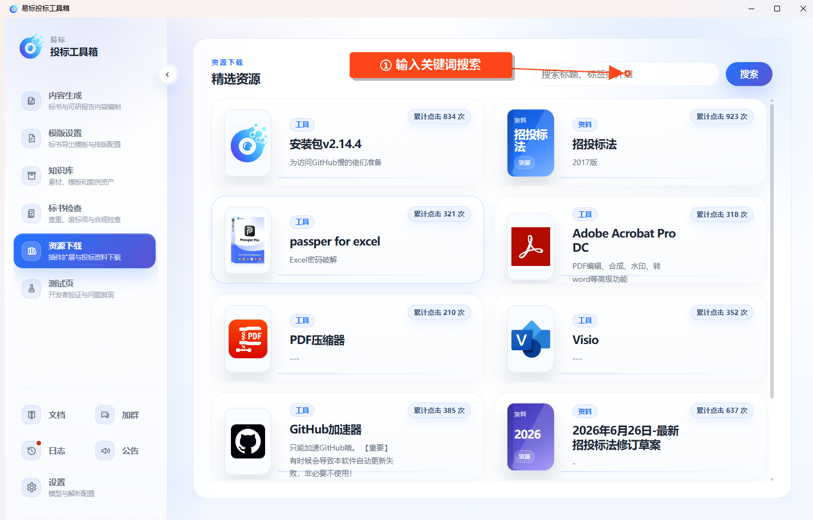

# 精选资源

入口为 **资源下载 → 精选资源**。

1. 等待资源列表加载，浏览标题、标签和简介。
2. 需要查找特定内容时，在右上角输入关键词，按标题、标签或介绍搜索。
3. 点击资源卡片查看详细说明。
4. 按详情中的下载链接获取文件，并留意资源自身的版本、适用范围和使用说明。

资源列表由在线服务提供，内容会更新。列表中的工具或资料需要按其说明下载和使用，点击资源卡片并不表示已经安装。
