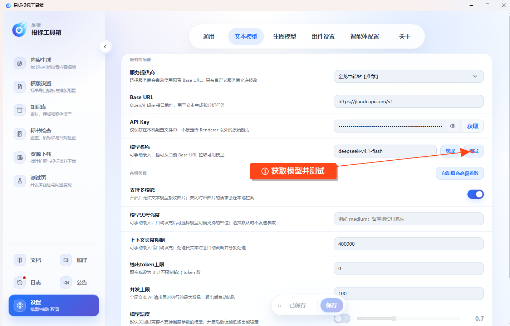

# 配置文本模型（必做）

点击左下角 **设置 → 文本模型**。招标解析、目录、正文和 AI 检查等功能使用这里保存的模型。

## 使用官方 API

1. 在服务提供商中选择 **官方 API**。
2. 按账户区域提示登录或绑定账户，查看余额并选择模型类型。
3. 需要补充余额时使用页面中的充值或兑换入口；订单、流水和开票在账户区域查看。
4. 点击 **测试**，确认可用后点击底部 **保存**。

官方账户会处理所需的接口配置，不需要像自定义服务一样手动填写 API Key。

## 使用其他服务

1. 选择服务提供商。预置服务会使用对应地址；选择 **自定义** 时填写服务商提供的 Base URL（接口地址）。
2. 填写 API Key（接口密钥）。
3. 点击模型名称旁的 **获取** 并选择模型，也可以手动输入准确的模型名称。
4. 按服务商支持的接口选择请求类型。
5. 点击 **测试**，成功后点击底部 **保存**。空回复不会被判定为测试成功。

如果失败，按页面提示检查接口密钥、地址、模型名称、账户余额和网络连接。

## 高级参数

可先点击 **自动填充高级参数**，再根据服务商的模型说明核对：

- **上下文长度限制**：填写模型能处理的上下文长度，长文档处理会据此分批。
- **最大输出 Token**：限制单次回复长度；填 0 表示不额外设置上限。
- **并发上限**：限制同时执行的文本请求数量，超出的请求排队。
- **思考强度**：只选择模型支持的档位；使用默认值时不额外发送该参数。
- **温度**：需要时开启并设置；默认关闭。
- **多模态支持**：按模型是否支持图片输入设置，不要只凭模型名称判断。

修改后点击 **保存**。如果提示上下文长度未设置，可返回此页补充或自动填充。
