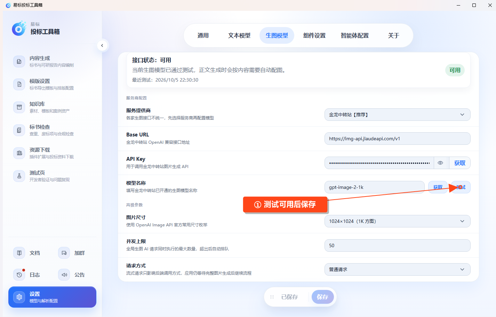

# 配置生图模型（可选）

需要在正文中生成 AI 图片时，进入 **设置 → 生图模型**。

## 常规生图服务

1. 选择服务提供商，按页面要求填写接口地址、API Key 和模型名称。
2. 支持获取模型列表的服务可以点击 **获取**，也可以直接填写模型名称。
3. 按服务能力设置图片尺寸、并发上限和请求类型。
4. 点击 **测试**，等待顶部接口状态显示“可用”，再点击 **保存**。

正文生成只有在生图模型可用时才能开启 AI 生图。更换配置后请重新测试。

## 使用 ComfyUI

服务提供商选择 **ComfyUI**，填写可访问的服务地址。工作流栏可以粘贴从 ComfyUI 的 **Save (API Format)** 导出的工作流 JSON；留空时，软件会尝试使用该服务器最近成功运行的文生图工作流。

按页面设置尺寸等参数，测试通过后保存。ComfyUI 服务需要在使用时保持可访问。

## 在投标文件中使用

进入 **内容生成 → 投标文件 → 生成设置 → 插图吗**，设置配图比例、布局和生图方式。

AI 生图配置是可选项。Mermaid 流程图和 HTML 图表由本机转成图片，不依赖生图接口；需要生成这些图表时仍须配置可用的文本模型。
