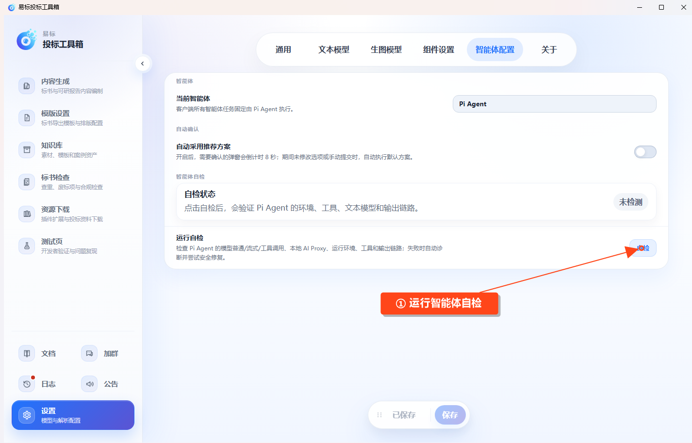

# 智能体配置

进入 **设置 → 智能体配置**。当前使用 **Pi Agent**，无需选择其他运行时。

## 自动采用推荐方案

开启后，任务中需要确认的弹窗会倒计时 8 秒。在倒计时内没有修改选项或手动提交，软件会采用默认方案。

需要逐项人工确认时关闭此项。修改设置后点击 **保存**。

## 智能体自检

遇到智能体启动、工具调用或任务执行异常时，点击 **自检**。软件会检查文本模型的普通回复、流式回复和工具调用，以及本地运行环境和输出链路，并尝试处理可以自动修复的问题。

等待页面显示自检结果，查看失败项及建议。显示“自检通过”或“自检通过（已自动修复）”后，再返回原任务按页面提示继续。
